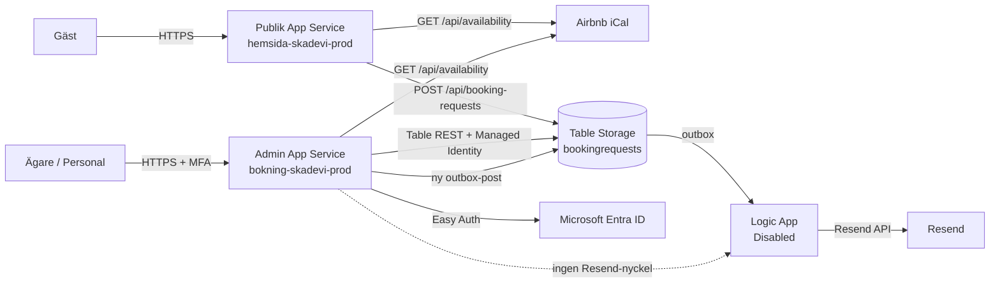
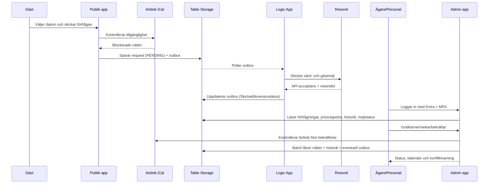

# Arkitekturrapport — Skadevi Bokningsportal

**Steg 8A — planering och dokumentation**
**Datum:** 2026-11-11
**Status:** Förslag, inte implementerat eller driftsatt
**Utgångspunkt:** `integration/resend-bokning` (commit `10ea903`)
**Måladress:** `https://bokning.skadeviherrgard.com`

> **Viktigt:** Detta dokument är en arkitektur- och planeringsleverans. Inga
> Azure-resurser har skapats eller ändrats, ingen DNS-ändring har gjorts, ingen
> implementation har påbörjats, inga commits/pushar har gjorts och
> `BOOKING_REQUESTS_ENABLED` samt Logic Apps är fortfarande avstängda.

---

## 0. Sammanfattning och rekommendation

Bygg portalen som en **separat App Service-app** i samma resursgrupp och på
samma befintliga App Service-plan (`asp-skadevi-prod`, B1 Linux) i Sweden
Central. Det ger en egen autentiseringsgräns, egen managed identity och egen
deployment utan att en ny plan behöver betalas. Appen får det nya namnet
`bokning-skadevi-prod` (eller `admin-skadevi-prod`) och adressen
`bokning.skadeviherrgard.com`.

Återanvänd befintlig Table Storage, bokningsmodell, prisberäkning,
kalenderlogik, Resend/Logic App-flöde och designspråk. Bygg administrationen
som **server-renderade sidor med små ES-moduler** i samma vanilla
HTML/CSS/JS-tradition som webbplatsen. Det undviker en ny frontendramverk- och
beroendekedja, minskar XSS-ytan och passar den låga volymen.

Använd **Microsoft Entra ID + App Service Authentication (Easy Auth)** med
approller `Owner` och `Staff`, tilldelning via Enterprise-appen och MFA via
Entra Security Defaults eller Conditional Access. Ingen egen
lösenordsdatabas. Skydda både sidor och `/api/admin/*`; server-side
rollkontroll är obligatorisk.

Behåll **Table Storage** för första versionen. Volymen är låg och behoven är
enkla. Introducera inte Azure SQL enbart för portalen. Komplettera med
`calendar`-poster (en rad per natt), `history`, `pricing`-revisioner och
utökade fält på befintliga `request`/`outbox`-poster. Använd ETag,
`If-Match`, batch-transaktioner per partition och explicita
statusövergångar.

Kalenderstrategin är konservativ: **endast bekräftade bokningar och manuella
blockeringar blockerar datum hårt**. Förfrågningar och preliminära bokningar
visas som mjuka överlägg och blockerar aldrig automatiskt. Airbnb iCal är
läsbar men inte en realtidslåsning; därför krävs intern dubbelbokningskontroll,
batch-låsning per natt, manuell Airbnb-blockering efter bekräftelse och tydlig
konfliktvarning.

**Rekommenderad första version:** läsbar dashboard, bokningslista,
bokningsdetaljer, säker status- och betalningshantering, månadskalender,
manuella blockeringar, historik och mejlstatus. Betalintegration, fakturering,
städplanering, rapporter och fler kanaler planeras men byggs inte nu.

---

## 1. Inventering av nuläget

### 1.1 Repository och brancher

Arbetsträdet är rent och står på `integration/resend-bokning` (commit
`10ea903`). Branchen är 52 commits före den lokala, äldre `main` och 15 commits
före `origin/main`. Det finns en viktig driftrisk i att lokal `main` inte är
samma sak som `origin/main` eller den kod som faktiskt ligger i Azure.

| Nivå | Innehåll |
|---|---|
| `origin/main` | Vite-webbplats, bokningsformulär, prisberäkning, Table Storage-modul, DNS-förberedelse samt en **äldre Gmail-baserad** Logic App-mall. |
| `integration/resend-bokning` (aktuell) | Allt ovan plus **Resend-flödet**, secret-scopad Key Vault-roll, isolerat testworkflow/testtabell, utkorgshärdning och testplan. |
| Live Azure | Har Resend-versionen av Logic App (Disabled), lagring, tabeller, hemligheter och DNS-zon. Live-webbappen svarar med bokningsregler v3, men saknar de appinställningar som krävs för att lagra bokningar. |
| Administration | Finns inte i någon branch och behöver byggas. |

**Slutsats:** `origin/main` är inte en tillräcklig källa för hela
Resend-lösningen. Innan utvecklingen startar måste man enas om en
gemensam huvudbranch och dokumentera vilken commit som är driftsatt. Annars
riskerar portalen att byggas mot ett API som inte är det som körs.

### 1.2 Verifierad Azure-inventering (läsbara frågor)

Inventeringen gjordes med `az` mot prenumerationen **Azure subscription 1**
(`7c9799f7-…`) och tenant `7169feeb-…`.

| Resurs | Namn | Status/observation |
|---|---|---|
| Resursgrupp | `rg-skadevi-prod` | Sweden Central |
| App Service-plan | `asp-skadevi-prod` | Linux, B1, en instans, always-on |
| Publik webbapp | `hemsida-skadevi-prod` | Running, system-assigned managed identity `e10c2b5e-…` |
| Webappens värdnamn | `www.skadeviherrgard.com`, `skadeviherrgard.com` | Bundna med SNI-certifikat, men publik DNS pekar fortfarande på Wix |
| Key Vault | `kv-skadevi-prod` | RBAC aktiverat; hemligheter `airbnb-ical-url`, `resend-api-key`, `resend-api-key-test` |
| Lagringskonto | `stskadevibokningprod` | Standard_LRS, Sweden Central, `allowSharedKeyAccess: false`, TLS 1.2 |
| Tabeller | `bookingrequests`, `bookingrequeststest` | Produktion respektive isolerad test |
| Tabell-RBAC | `Storage Table Data Contributor` | På tabellnivå för webbappen och Logic Appens identitet |
| Logic App | `logic-skadevi-bokningsnotis` | **Disabled**, Resend via HTTP, Recurrence 5 min, concurrency 1, managed identity |
| Test-Logic App | `logic-skadevi-bokningsnotis-test` | **Disabled** |
| DNS-zon | `skadeviherrgard.com` | Finns i Azure (global), men är **inte publikt delegerad** |
| Publik DNS | Wix | `NS ns0.wixdns.net`, `NS ns1.wixdns.net`; `www` pekar på Wix CDN |
| `bokning` | Saknas | `bokning.skadeviherrgard.com` svarar inte i publik DNS |
| Azure SQL | — | Finns inte |
| App Insights/Log Analytics | — | Inte registrerat/aktiverat för appen |
| Deployment slots | — | B1 saknar slots |

Webbappens appinställningar innehåller endast:

- `NODE_ENV=production`
- `AIRBNB_ICAL_URL` som Key Vault-referens

Det finns **ingen** `AZURE_STORAGE_ACCOUNT_NAME` och ingen
`BOOKING_REQUESTS_ENABLED` i live-appen. Det betyder att inskick är avstängt
enligt standardvärdet och att den durabla lagringen inte är inkopplad i den
körande appen, även om lagringskontot och tabellen finns.

Publika `https://www.skadeviherrgard.com/api/...` svarar 404 eftersom domänen
fortfarande går till Wix. På `hemsida-skadevi-prod.azurewebsites.net` svarar
`/api/booking-rules` med regler v3 och `/api/availability` med kalenderdata,
vilket visar att bokningskoden är driftsatt där.

### 1.3 Vad som finns, var det finns och vad som saknas

| Komponent | `origin/main` | `integration/resend-bokning` | Live Azure | Bedömning |
|---|---:|---:|---:|---|
| Vite-webbplats, bokningsformulär, prissidor | Ja | Ja | Ja | Återanvänd |
| Serverbaserad prisberäkning och prissnapshot | Ja | Ja | Ja | Återanvänd; läs aldrig om priset i admin |
| Table Storage `bookingrequests` | Modul finns | Ja | Ja | Återanvänd |
| `request`- och `outbox`-partitioner | Ja | Ja | Ja | Utöka additivt |
| Logic App + Resend | Nej (Gmail-version) | Ja | Ja, Disabled | Återanvänd, aktivera inte nu |
| Test-Logic App/testtabell/testnyckel | Nej | Ja | Ja, Disabled | Använd för isolerad verifiering |
| Key Vault-roll scopad till enskilt secret | Nej | Ja | Ja | Återanvänd mönstret |
| Azure DNS-zon | Ja (förberedelse) | Ja | Ja, ej delegerad | Ändra inte nu |
| Administrationsportal | Nej | Nej | Nej | Bygg |
| Admin-autentisering/roller | Nej | Nej | Nej | Bygg |
| Intern kalender och manuella block | Nej | Nej | Nej | Bygg |
| Ändringshistorik/audit | Nej | Nej | Nej | Bygg |
| Betalningsintegration | Nej | Nej | Nej | Planera, bygg inte |
| Leveransbekräftelse från Resend | Nej | Delvis (fält finns) | Nej | Bygg i senare etapp |

### 1.4 Viktiga observationer som påverkar arkitekturen

1. **Live-appen är inte fullt ihopkopplad.** Lagringskontot finns, men
   webbappen saknar `AZURE_STORAGE_ACCOUNT_NAME`. Inskick är därför stängt
   både genom kill switch och genom att lagringen inte är konfigurerad.
2. **Logic App är driftsatt men Disabled.** Den får inte aktiveras i detta
   steg. Resend-nyckeln finns i Key Vault och rollen är scopad till just det
   secretet.
3. **Domänen är inte cutover.** Azure DNS-zonen finns, men publik DNS är
   fortfarande Wix. `www` går inte till Azure. Därför får inga DNS-ändringar
   göras förrän överföringen till GoDaddy är klar och särskilt godkänd.
4. **B1 är en enda instans utan slots.** En separat admin-app på samma plan
   ger separationsvinster men delar CPU/minne. Det är acceptabelt för låg
   adminvolym, men övervaka resurserna.
5. **Priserna är redan snapshottade.** `server/booking/requests.js` sparar
   `lodgingBase`, `discount`, `addonLines`, `total`, `pricing` och
   `priceVersion`. Admin får visa dessa och aldrig räkna om med dagens regler.
6. **Utkorgen saknar `reference` och `mailType`.** Nuvarande
   `toOutboxEntity()` sparar bara mejlfälten. Admin behöver kunna koppla ett
   mejl till en bokning utan att parsa RowKey. Lägg till dessa fält för nya
   poster.

---

## 2. Rekommenderad teknisk arkitektur

### 2.1 Översikt



**Principer:**

- Den publika webbappen och admin-appen är **separata App Service-appar**.
- Admin-appen har **ingen åtkomst till Resend-nyckeln** och skickar aldrig
  mejl direkt. Den lägger bara nya utkorgsposter i Table Storage; Logic App
  är enda vägen till Resend.
- Båda apparna använder samma tabell och samma managed-identity-baserade
  dataplansåtkomst. Inga kontonycklar.
- Admin-appen får bara `Storage Table Data Reader` på tabellen
  `bookingrequests`, inte på lagringskontot eller prenumerationen.
- Den publika appens beteende ändras inte i detta steg. När interna
  bekräftade bokningar ska blockera publika datum blir det en separat,
  godkänd ändring i etapp 2.

### 2.2 Separat App Service eller befintlig app?

| Alternativ | Säkerhet | Kostnad | Drift | Bedömning |
|---|---|---|---:|---|
| Befintlig app + `/admin` | Delar process, konfiguration och deployment med publika sajten. Easy Auth måste undanta publika paths, vilket ökar risken för feldoning. | 0 kr extra | En deployment påverkar båda | Avråds för första versionen |
| **Separat app på befintlig plan** | Egen auth-gräns, egen managed identity, egen deployment, egen domän. Hela appen kan kräva auth. | **0 kr extra compute** (delar B1) | Låg adminvolym; delar CPU/minne | **Rekommenderas** |
| Separat app på egen B1-plan | Starkast resursisolering; ingen påverkan på publika sajten vid adminlast | ≈130–140 kr/mån extra | Mer att drift­a, men enkelt | Välj om B1 får resursbrist |
| Azure Functions/Static Web Apps | Kräver omskrivning av server/API och ger kallstart/ny modell | Låg | Mer komplexitet | Avråds |

**Rekommendation:** `bokning-skadevi-prod` på befintlig `asp-skadevi-prod`.
Flytta till egen plan först om CPU/minne eller driftstörningar motiverar det.

### 2.3 Runtime och frontend

- **Node.js 22 Linux**, samma runtime som publika appen.
- **Server-renderade sidor** med små, progressivt förbättrade ES-moduler.
  Ingen ny frontendramverk, ingen ny runtime-dependency.
- Vite används för att bygga admin-CSS/JS till `dist-admin/`; admin-appen
  serverar endast den katalogen och admin-API:t.
- Återanvänd designspråket från `src/css/style.css`: Libre Baskerville för
  rubriker, Inter för brödtext, ivory/kol/brun/guld, tunna guldlinjer och
  generös vitrymd. Admin får en tätare, mer funktionell variant av samma
  identitet.
- Server-rendering är ett medvetet säkerhetsval: användardata escapas på
  servern, ingen känslig data hamnar i en publik SPA-shell och ingen
  klientrouter behöver skydda data.

### 2.4 Föreslagen kodstruktur

```text
admin/
  css/admin.css
  js/admin.js, calendar.js, booking-detail.js, filters.js
server/admin/
  index.js              egen HTTP-server för admin-appen
  auth.js               Easy Auth-principal, roller, CSRF
  routes/
    dashboard.js, bookings.js, calendar.js, emails.js, export.js
  repository/
    bookings.js, calendar.js, history.js, outbox.js
  views/
    layout.js, dashboard.js, bookings.js, booking-detail.js, calendar.js
  security.js           headers, origin-check, rate limit, escaping
shared/
  pricing-config.json   befintlig, återanvänds
  booking-status.js     gemensamma statuskoder/etiketter (ny)
infra/modules/admin-webapp.bicep
.github/workflows/deploy-admin.yml
```

Den publika servern (`server/index.js`) ska inte få admin-routes. Admin får
en egen entrypoint som importerar befintliga moduler:

- `server/calendar/availability.js` för iCal.
- `server/booking/pricing.js` och `shared/pricing-config.json` endast vid
  skapande av ny manuell bokning.
- `server/booking/rules.js` och `refund.js` för villkor.
- `server/booking/store.js` för tokenprovider/Table-anrop; additiva exports
  eller en tunn admin-repository som återanvänder samma REST-mönster.

### 2.5 Deployment

- Egen GitHub Actions-workflow `deploy-admin.yml` med egen miljö
  (`admin-prod`) och manuellt godkännande.
- Egen OIDC-identitet eller utökad, strikt scopad roll: `Website Contributor`
  endast på admin-appen. Den befintliga identiteten har redan en snäv roll på
  publika appen och ska inte breddas.
- Deployment-paketet innehåller `dist-admin/`, `server/admin/`, nödvändiga
  delar av `server/booking/` och `server/calendar/`, `shared/` samt
  produktionsberoenden. Publika sajtens paket ändras inte.
- Inga hemligheter i repo, workflow eller loggar.

---

## 3. Vad som återanvänds och vad som byggs

### 3.1 Återanvänds

| Befintlig komponent | Används till |
|---|---|
| `server/calendar/availability.js` + `calendar-worker.js` | Airbnb iCal, timeout, storleksgräns, parserisolering, “okänd = inte ledig” |
| `server/booking/store.js` | Managed identity, Table REST, idempotens, referensuppslag, utkorg |
| `server/booking/pricing.js` + `shared/pricing-config.json` | Ny manuell bokning och prisregler; aldrig omräkning vid visning |
| `server/booking/requests.js` | Validering, referensgenerering, notisbygge, escapeHtml, idempotensmönster |
| `server/booking/rules.js`, `house-rules.json` | Publicerade regler och regelversion |
| `server/booking/refund.js` | Avbokningsprocent 100/50/0 |
| `server/booking/mail.js` | Mottagare/reply-to; Resend-avsändare ligger i Logic App |
| Logic App + Resend + Key Vault + utkorg | Mejlutskick och status; admin lägger bara nya utkorgsposter |
| `stskadevibokningprod` + tabellen | Lagring; utökas med nya partitioner |
| `src/css/style.css`, typsnitt, logotyp | Visuell identitet |
| DNS-/certifikatmönster i `infra/` | Endast som referens; inga ändringar nu |

### 3.2 Byggs nytt

1. Admin App Service-app med Easy Auth, managed identity och egen deployment.
2. Entra-appregistrering med approller `Owner`/`Staff`, assignment required.
3. Admin-server, API, repository och server-renderade vyer.
4. Dashboard, bokningslista, bokningsdetaljer, kalender och manuell bokning.
5. Utökad datamodell: statuskoder, betalstatus, källa, version, historik,
   prisrevisioner, kalenderblock, mejltyp/referens/leveransstatus.
6. Statusmaskin, ETag/optimistisk låsning, batch-låsning per natt,
   idempotens för adminåtgärder.
7. Kalenderaggregation: interna bokningar + manuella block + Airbnb +
   mjuka förfrågningar, konfliktvarning och fräschör.
8. Mejlstatus i admin, manuell omsändning med dubblettskydd och senare
   leveranskontroll.
9. Audit/ändringshistorik, säkerhetsrubriker, CSRF/XSS-skydd och tester.
10. Backup/export, retention, drift­runbook och övervakning.
11. I senare etapp: betalning, fakturering, städning, rapporter, fler kanaler.

---

## 4. Inloggning och säkerhet

### 4.1 Rekommenderad lösning

**Microsoft Entra ID + App Service Authentication (Easy Auth)** på en separat
admin-app.

- En enda tenant (Skadevis).
- Appregistrering `skadevi-bokning-admin` med approller:
  - `Owner` — full behörighet.
  - `Staff` — operativ åtkomst enligt matrisen nedan.
- Enterprise-appen har **Assignment required = Yes**. Endast uttryckligen
  tilldelade användare/grupper kan logga in. Ingen självregistrering.
- Easy Auth kräver autentisering på **alla** routes, inklusive
  `/api/admin/*`. Ingen anonym åtkomst till kunddata.
- MFA via Entra **Security Defaults** (kostnadsfritt) eller **Conditional
  Access** med krav på MFA och, om önskvärt, compliant device. Conditional
  Access kräver Entra ID P1 per administratör.
- Ingen egen lösenordsdatabas, inga lokala adminkonton och inga
  inbjudningslänkar med egna hemligheter.
- Utloggning via `/.auth/logout` med post-logout-redirect till en publik
  informationssida.

**Varför inte egen auth/MSAL i appen?** Easy Auth ger mindre kod, färre
säkerhetsmisstag och inbyggd tokenvalidering. MSAL i Node skulle ge mer
kontroll men också mer kod, sessionshantering och underhåll. Auth0/Clerk
tillför en leverantör och kostnad utan att lösa ett problem som Entra redan
löser i Azure-miljön.

### 4.2 Roll- och behörighetsmatris

| Åtgärd | Owner | Staff | Kommentar |
|---|---:|---:|---|
| Se dashboard, lista, detaljer, historik | Ja | Ja | Alla admins ser alla bokningar |
| Söka/filtrera/sortera | Ja | Ja | |
| Lägga intern anteckning | Ja | Ja | Loggas med användare och tid |
| Godkänna förfrågan till preliminär | Ja | Ja | Ingen kalenderblockering |
| Neka förfrågan | Ja | Ja | Kräver orsak; valfritt mejl |
| Bekräfta bokning | Ja | Nej | Bindande; blockerar kalender |
| Avboka bekräftad bokning | Ja | Nej | Påverkar återbetalning |
| Ändra tillval/pris | Ja | Nej | Kräver orsak och historik |
| Hantera betalstatus manuellt | Ja | Nej | Ekonomisk åtgärd |
| Skapa manuell bokning | Ja | Nej | Ekonomisk/bindande åtgärd |
| Skapa/ta bort manuellt kalenderblock | Ja | Ja | Kräver orsak |
| Skicka om mejl manuellt | Ja | Ja | Endast via utkorgen; dubblettskydd |
| Exportera CSV/Excel | Ja | Nej | Personuppgifter |
| Hantera administratörer | Ja | Nej | Görs i Entra, inte i portalen |

Matrisen är ett förslag och ska bekräftas av Skadevi. Den viktiga principen är
att **servern**, inte gränssnittet, avgör behörigheten. Staff får 403 på
Owner-åtgärder även om knappen skulle synas.

### 4.3 Skydd för sidor och API:er

- Alla admin-routes kräver Easy Auth. Inga undantag för `/api/admin/*`.
- Servern tolkar `X-MS-CLIENT-PRINCIPAL` (base64-JSON) och verifierar
  `oid`, `roles` och att principal-ID finns. App Service tar bort klientens
  egna inkommande `X-MS-*`-rubriker; appen får aldrig lita på dem utanför
  App Service.
- Varje endpoint deklarerar minsta roll. Owner-only-åtgärder kontrolleras
  separat i serverlogiken, inte bara i vyn.
- **CSRF:** alla muterande anrop kräver:
  - `Origin`/`Referer` som matchar admin-domänen,
  - `Sec-Fetch-Site` som inte är `cross-site`,
  - en CSRF-token i header (`X-CSRF-Token`) eller dolt formulärfält,
  - SameSite=Lax/Secure-cookie från Easy Auth.
  Token utfärdas per session, lagras server-side i minnet (B1 är en instans)
  och roteras vid inloggning. Vid framtida scale-out byts det mot signerad
  token med nyckel i Key Vault eller distribuerad cache.
- **XSS:** CSP med nonce, inga inline-handlers, all användardata escapas,
  `textContent` i stället för `innerHTML` för gästfält/anteckningar. Mejl-HTML
  escapas redan i `requests.js`; admin ska inte rendera gästens fritext som
  HTML.
- **Klickjacking:** `frame-ancestors 'none'`, `X-Frame-Options: DENY`.
- **Open redirect:** endast relativa retur-URL:er efter login.
- **Rate limit:** admin-mutationer per användare/IP; skydd mot massändringar.
- **Idempotens:** varje muterande adminåtgärd har `Idempotency-Key` eller
  `If-Match`; dubbelklick kan inte skapa dubbla statusbyten eller mejl.
- **Ingen CORS:** admin-API:t svarar endast samma origin. Inga
  `Access-Control-Allow-Origin`.
- **No-store:** alla admin-svar `Cache-Control: no-store`.
- **Noindex:** `X-Robots-Tag: noindex, nofollow`, robots.txt disallow och
  ingen sitemap. Detta är komplement, inte skydd.

### 4.4 Azure-minsta behörighet

- Egen system-assigned managed identity för admin-appen. Återanvänd inte
  publika appens identitet.
- `Storage Table Data Reader` **endast på tabellen**
  `bookingrequests`. Ingen roll på lagringskontot, resursgruppen eller
  prenumerationen.
- Admin-appen behöver **ingen Key Vault-åtkomst**: den hanterar inga
  Resend-nycklar, iCal-URL:er eller andra hemligheter. Det är en medveten
  minskning av attackyta.
- Inga kontonycklar; `allowSharedKeyAccess: false` ligger kvar.
- Deployment-identiteten får `Website Contributor` endast på admin-appen.
- Inga nya breda `Owner`- eller `Contributor`-tilldelningar.
- Resend-nyckeln fortsätter att vara scopad till enskilt secret för Logic
  Appens identitet.

### 4.5 Loggning, audit och GDPR

- **Audit i Table Storage** är primär logg: aktör (objekt-ID, visningsnamn),
  åtgärd, referens, från/till-status, orsak, tidpunkt och korrelations-ID.
  Historiken är append-only.
- Logga inte hela gästposten, e-postinnehåll eller betalningsdetaljer i
  applikationsloggar. Använd referens och fältnamn.
- Strukturerad JSON-logg till stdout för drift; App Insights är valfritt och
  kan läggas till senare om man vill ha frågor/larm. Det behövs inte för v1.
- GDPR: dataminimering, 24-månadersretention enligt befintlig rutin, separat
  hantering av bokföringsunderlag om betalning/faktura införs. Resends
  personuppgiftsbehandling, eventuella tredjelandsoverföringar och DPA måste
  vara godkända innan mejl aktiveras. Admin får inte skicka kunddata till
  tredje part.
- Radering/export av personuppgifter ska kunna göras av Owner med historik;
  radering får inte tyst radera revisionsspår som krävs enligt lag. Detta
  behöver juridiskt förtydligas före betalintegration.

---

## 5. Datamodell

### 5.1 Utgångspunkt

Befintlig tabell `bookingrequests` har i dag:

- `PartitionKey='request'`, `RowKey=<idempotensnyckel>` för förfrågningar.
- `PartitionKey='outbox'`, `RowKey=outbox-<idempotensnyckel>-<key>` för mejl.
- Fält som referens, status, datum, gäster, kontaktuppgifter, tillval,
  rabatt, prisoffert, prisversion, regelversion och tidsstämplar.

Detta räcker som bas. Vi behöver inte migrera till SQL. Däremot behöver
posterna utökas och nya partitioner tillkomma.

### 5.2 Föreslagna entiteter och partitioner

| Entitet | PartitionKey | RowKey | Viktiga fält | Syfte |
|---|---|---|---|---|
| Bokning/förfrågan | `request` | idempotensnyckel (oförändrat) | `reference`, `statusCode`, `status`, `arrival`, `departure`, `nights`, `guests`, gästfält, `bookingSource`, `createdAt`, `updatedAt`, `version`, `confirmedAt`, `cancelledAt`, `airbnbBlockedAt` | Kanonisk bokningspost; manuell bokning använder `manual-<uuid>` som RowKey |
| Betalning (på bokningen) | `request` | samma | `paymentStatus`, `amountTotal`, `amountPaid`, `balance`, `currency`, `paymentMethod`, `paymentNote`, `paymentUpdatedAt/By` | Manuell betalstatus tills integration finns |
| Utkorg/mejl | `outbox` | `outbox-<nyckel>-<mailType>` | `reference`, `mailType`, `mailTo`, `mailSubject`, `status`, `attemptCount`, `resendId`, `deliveryStatus`, `acceptedAt`, `deliveredAt`, `bouncedAt`, `failedAt`, `manualReviewReason`, `resendOf` | Resend/Logic App och adminens mejlstatus |
| Kalenderblock | `calendar` | `YYYY-MM-DD` | `type` (`BOOKING`/`MANUAL`), `reference`/`blockId`, `source`, `note`, `createdBy`, `createdAt`, `updatedAt`, `expiresAt` | En rad per natt; hård blockering |
| Historik | `history` | `<reference>_<ISO8601Z>_<random>` | `reference`, `actorId`, `actorName`, `action`, `fromStatus`, `toStatus`, `changes`, `reason`, `correlationId`, `at` | Append-only ändringshistorik |
| Prisrevision | `pricing` | `<reference>_<revision>_<ISO>` | `reference`, `revision`, `source` (`ORIGINAL`/`ADMIN_ADJUSTMENT`), `lines`, `lodgingBase`, `discount`, `total`, `priceVersion`, `createdBy`, `reason` | Oföränderliga prissnapshot vid ändring |
| Adminåtgärd | `adminaction` | Idempotensnyckel | `action`, `reference`, `actorId`, `result`, `createdAt`, `expiresAt` | Dubblettskydd för manuell bokning/omsändning |

**Varför en rad per natt i `calendar`?** Table Storage kan göra en atomisk
batch-transaktion inom samma partition. En bokning på upp till 93 nätter ryms
under gränsen 100 operationer. Genom att infoga en rad per natt med
`If-None-Match: *` kan två samtidiga bekräftelser inte båda lyckas. Detta är
den enklaste robusta lösningen utan distribuerad låsning.

### 5.3 Utökade fält på bokningen

Följande fält bör läggas till (additivt, utan att ändra befintliga fälts
betydelse):

- `statusCode`: `PENDING`, `PRELIMINARY`, `CONFIRMED`, `DECLINED`,
  `CANCELLED`. `status` behålls som svensk visningstext under övergången.
- `bookingSource`: `WEB`, `MANUAL`, `AIRBNB`, `PHONE`, `EMAIL`, `OTHER`.
- `version`: heltal som ökas vid varje ändring; används med ETag.
- `updatedAt`, `updatedBy`, `confirmedAt`, `declinedAt`, `cancelledAt`.
- `cancellationReason`, `refundPercent`, `refundAmount`.
- `airbnbBlockedAt`, `airbnbBlockedBy` — operativ kvittens att datum är
  blockerade i Airbnb.
- `paymentStatus` och betalningsfälten ovan.
- `latestNote` för snabb visning; fullständiga anteckningar ligger i
  historiken.
- `searchName`, `searchEmail` (normaliserade) för prefixsökning.
- `schemaVersion` för framtida migreringar.
- `pricingRevision` som pekar på aktuell `pricing`-post.

**Statuskoder kontra svenska strängar:** Dagens poster använder svenska
statusvärden. Eftersom produktionsinskick är avstängt och lagringen sannolikt
inte innehåller skarpa bokningar kan man införa ASCII-koder nu. Om poster
finns ska läsningen mappa äldre värden (`Inväntar godkännande` m.fl.) till
koderna. Skriv aldrig två sanningar utan att mappa på ett ställe.

### 5.4 Statusmaskin och tillåtna övergångar

| Åtgärd | Från | Till | Roll | Kalender | Mejl | Krav |
|---|---|---|---|---|---|---|
| Skapa förfrågan (gäst) | — | `PENDING` | publik | Nej | Värd + gäst | Kill switch, regler, lagring, idempotens |
| Godkänn (preliminär) | `PENDING` | `PRELIMINARY` | Owner/Staff | Nej | Valfritt | Orsak ej obligatorisk |
| Neka | `PENDING`/`PRELIMINARY` | `DECLINED` | Owner/Staff | Nej | Valfritt | Orsak obligatorisk |
| Bekräfta | `PENDING`/`PRELIMINARY` | `CONFIRMED` | Owner | Ja, efter kontroll | Bekräftelse | Ingen konflikt; ETag |
| Avboka | `CONFIRMED` | `CANCELLED` | Owner | Ta bort block | Avbokningsmejl | Orsak; återbetalningsberäkning |
| Skapa manuell bokning | — | `CONFIRMED` | Owner | Ja | Valfritt | Prisoffert sparas |
| Ändra tillval | `PENDING`/`PRELIMINARY`/`CONFIRMED` | samma | Owner | Nej | Valfritt | Ny prisrevision + historik |
| Ändra betalstatus | valfri aktiv | samma | Owner | Nej | Valfritt | Historik, belopp, metod |
| Manuellt block | — | — | Owner/Staff | Ja | Nej | Orsak; ingen överlapp med bokning |

**Ingen automatisk övergång finns.** Ett schemajobb får flagga “kräver
åtgärd” (t.ex. förfrågan äldre än 3 dagar) men får inte byta status, neka
eller bekräfta. Det uppfyller kravet att ingen godkännandeåtgärd är
automatisk.

**Tolkning av “Godkänn”:** Rapporten rekommenderar att “Godkänn förfrågan”
går till `PRELIMINARY` och att “Bekräfta bokning” går till `CONFIRMED`.
Därmed blir det tydligt att endast bekräftelse blockerar datum. Om Skadevi
hellre vill att “Godkänn” är bindande kan etiketten ändras, men
statusmaskinen och kalenderregeln bör behållas.

### 5.5 Samtidighet, idempotens och säkra statusbyten

- **Optimistisk låsning:** läs bokningen med ETag, kontrollera övergången,
  skriv med `If-Match`. Vid 412 returneras `409 Conflict` med aktuell status
  och version. Den andra administratören får uppdatera och försöka igen.
- **Batch-låsning:** bekräftelse infogar alla nätter i en `$batch` med
  `If-None-Match: *`. Om någon natt redan är blockerad misslyckas hela
  batchen och ingen delvis blockering uppstår.
- **Idempotens:** gästens `Idempotency-Key` finns kvar. Adminmutationer får
  egen `Idempotency-Key`; resultatet sparas i `adminaction` eller kan härledas
  från att statusen redan är den begärda. Manuell bokning använder
  deterministisk RowKey `manual-<key>`.
- **Inga tysta överskrivningar:** en ändring kräver `expectedVersion` eller
  ETag. UI:t visar “Någon annan har ändrat bokningen — uppdatera sidan”.
- **Transaktioner:** Table Storage saknar transaktioner över partitioner.
  Därför hålls bokning, kalender och historik i en ordning där kalendern är
  den hårda spärren och historiken skrivs efter lyckad ändring. Om
  historikskrivningen misslyckas ska åtgärden rapporteras som delvis
  misslyckad och aldrig tystas; en reparationsrutin kan skriva historiken.
- **Datumändring av bekräftad bokning:** byggs inte i v1. Den kan kräva fler
  än 100 batch-operationer (gamla + nya nätter). V1 hanterar avbokning +
  ny bokning, eller Owner-only ändring i en senare etapp med tvåfas och
  explicit konfliktkontroll.

### 5.6 Table Storage eller Azure SQL?

**Table Storage räcker för v1.** Skäl:

- Volymen är låg (hundratals bokningar per år, inte tusentals per dag).
- Data är enkla entiteter utan joins.
- Befintlig lagring, RBAC, managed identity och kod återanvänds.
- Kostnaden är några kronor per månad.
- Partitioner och radnycklar kan designas för de få queries som behövs.

**Begränsningar och motåtgärder:**

| Begränsning | Motåtgärd |
|---|---|
| Ingen server-side `contains`-sökning | Normaliserade `searchName`/`searchEmail` och prefixfilter; annars bounded scan + in-memory filter |
| Ingen sortering på godtyckliga kolumner | Hämta ett begränsat tidsfönster (t.ex. 12 månader eller max 2 000 poster) och sortera i serverminnet |
| Inga joins | Bädda in gäst och pris på bokningen; separata historik-/mejlposter slås ihop i applikationslagret |
| Transaktioner endast inom partition | En rad per natt i `calendar`; batch per partition |
| Ingen `LIKE`/fulltext | Prefixsökning; senare Azure SQL/search om volymen växer |
| Ingen inbyggd rapportering | Server-side aggregering över begränsat dataset; export till CSV |

Azure SQL införs först när man faktiskt behöver joins, komplex rapportering,
flera samtidiga skrivare över många entiteter eller volym som gör scan
olämplig. Det är inte motiverat enbart för en administrationsportal.

### 5.7 Retention, backup och återställning

- Befintlig gallringsrutin (`scripts/purge-old-bookings.mjs`) är 24 månader
  som standard. Den ska utökas till nya partitioner och aldrig radera
  pågående/aktiva bokningar.
- Standard_LRS ger ingen geo-redundans. För v1: daglig export av bokningar,
  historik och kalender till en separat blobcontainer (eller ett separat
  lagringskonto) och testad återställning. Överväg GRS om dataförlust är
  oacceptabel; kostnaden är fortfarande låg.
- Historik ska bevaras så länge den behövs för tvist/avtal och eventuell
  bokföring. Betalningsunderlag kan omfattas av bokföringskrav (7 år) och
  måste hanteras separat från bokningsförfrågningar. Detta ska juridiskt
  bekräftas innan betalintegration.
- Backuper ska vara krypterade och åtkomststyrda; ingen export med
  kunduppgifter i klartext i e-post eller repo.

---

## 6. Bokningsflöde från gäst till administratör



### 6.1 Steg för steg

1. **Datumval.** Gästen väljer ankomst/avresa i befintlig kalender.
   Tillgänglighet kommer från Airbnb iCal via `/api/availability`. Okänd
   tillgänglighet behandlas som inte ledig.
2. **Inskick.** Klienten skickar idempotensnyckel. Servern kontrollerar
   kill switch, publicerade regler, durabel lagring, rate limit, fält,
   honungsgrop, regelversion och tillgänglighet på nytt.
3. **Sparande.** Servern beräknar/prissätter, genererar unik referens och
   sparar `PENDING` i `request`. Två utkorgsposter (värd och gäst) skapas i
   samma lagring. Misslyckad lagring ger 500 och ingen bekräftelse.
4. **Mejl.** Logic App pollar utkorgen och skickar via Resend. API-acceptans
   sparas som `Skickad` + `resendId`; leverans/studs är en separat status.
5. **Admin.** Ägare/personal loggar in. Dashboard visar nya förfrågningar,
   kommande bokningar, gästantal, värde, betalningar och åtgärdskrävande
   poster.
6. **Bedömning.** Admin öppnar detaljerna och ser prissnapshot, tillval,
   gästönskemål, källa, historik och mejlstatus. Inga priser räknas om.
7. **Godkännande.** “Godkänn” gör förfrågan preliminär utan att blockera
   datum. “Bekräfta” kontrollerar Airbnb och interna nätter, batch-låser
   nätterna och skickar bekräftelse.
8. **Nekning/avbokning.** Nekning kräver orsak och blockerar inget.
   Avbokning tar bort nätter, beräknar återbetalning enligt policyn och
   uppdaterar betalstatus manuellt.
9. **Manuell bokning.** Owner skapar en bokning, servern tar en prisoffert
   vid skapandet, och först en explicit bekräftelse låser kalendern.
10. **Uppföljning.** Dashboarden flaggar överlapp, osäker mejlleverans,
    saknad Airbnb-blockering och obetalda belopp. Allt loggas.

---

## 7. Kalender och dubbelbokningsstrategi

### 7.1 Datakällor och prioritet

| Källa | Hård blockering? | Var den finns | Kommentar |
|---|---:|---|---|
| Bekräftad bokning från portalen | Ja | `calendar`-partitioner, en rad/natt | Intern sanning |
| Manuellt block | Ja | `calendar`-partitioner | Underhåll, egen vistelse, extern kanal |
| Airbnb iCal | Ja för publik tillgänglighet | Live via `/api/availability` | Läsbar, inte realtid, ingen push |
| Förfrågan `PENDING` | Nej | `request` | Mjukt överlägg; får aldrig blockera |
| Preliminär `PRELIMINARY` | Nej (som standard) | `request` | Kan vid behov kombineras med separat manuellt block |
| Nekad/avbokad | Nej | `request` | Historik |

**Konfliktprecedens:** om två hårda källor överlappar varandra visas en
konflikt. Den löses aldrig automatiskt. Publik tillgänglighet ska på sikt
beräknas som unionen av Airbnb, bekräftade interna bokningar och manuella
block. Förfrågningar ingår aldrig i den unionen.

### 7.2 Vad Airbnb iCal kan och inte kan

- iCal är en **export** av Airbnb-kalendern. Den kan läsas men inte användas
  för att boka, ändra eller blockera hos Airbnb.
- Uppdateringsfrekvensen är leverantörens, inte vår. Det finns ingen garanti
  för realtid. Behandla den som **eventually consistent**.
- Vi kan inte förhindra att en Airbnb-bokning skapas strax efter en intern
  bekräftelse. Därför krävs:
  1. intern batch-låsning,
  2. kontroll mot Airbnb precis före bekräftelse,
  3. manuell blockering i Airbnb efter bekräftelse,
  4. konfliktvarning om iCal senare visar överlapp.
- Rekommenderad uppdatering: cache i 5 minuter, manuell “Uppdatera nu” i
  admin och varning om datan är äldre än 15 minuter. Polla inte iCal oftare
  än nödvändigt. Serverns befintliga 5 s timeout, 1 MB-gräns och
  “okänd = inte ledig” behålls.

### 7.3 Bekräftelsealgoritm (planerad)

```text
1. Läs bokningen med ETag; kräv status PENDING/PRELIMINARY.
2. Kontrollera roll Owner och att inga nätter redan finns i calendar.
3. Hämta Airbnb iCal färskt (cache max 5 min); om okänd -> stoppa och visa fel.
4. Kontrollera att ingen natt är blockerad av Airbnb eller intern kalender.
5. Skapa en batch med en rad per natt (max 93) med If-None-Match: *.
6. Om batch misslyckas: returnera 409 med vilka nätter som krockar; inget skrivs.
7. Uppdatera bokningen till CONFIRMED med If-Match.
8. Skriv historik (actor, från/till, tid, orsak).
9. Lägg eventuell bekräftelsemejlspost i outbox.
10. Sätt airbnbBlockedAt = null; visa “Blockera i Airbnb” som åtgärd.
```

Punkt 5 och 7 kan inte bli en enda transaktion över partitioner. Därför är
kalendern den hårda spärren. Rekommendationen är att skriva kalenderraderna
först och därefter bokningen, med en repair-post i `adminaction` som kan
slutföra eller rulla tillbaka om den andra skrivningen misslyckas. Alternativet
att skriva bokningen först kan lämna en `CONFIRMED`-bokning utan kalenderblock
vid en krasch och avråds. Den exakta ordningen ska fastställas och
felinjiceras i implementationssteget.

### 7.4 Förfrågningar och preliminära bokningar

- En förfrågan får **aldrig automatiskt** skapa kalenderrader.
- Flera förfrågningar för samma datum är tillåtna; de visas som mjuka
  överlägg med överlappsvarning, precis som dagens `overlaps`-fält.
- En preliminär bokning är ett beslut, inte en låsning. Om Skadevi vill hålla
  datum måste en Owner/Staff uttryckligen skapa ett manuellt block med
  utgångsdatum; det loggas separat och syns tydligt.
- När en förfrågan nekas eller en preliminär bokning avbokas tas inga
  kalenderrader bort eftersom inga skapades.
- Dashboarden visar “förfrågan väntar X dagar” och överlapp, men ändrar
  aldrig status automatiskt.

### 7.5 Kalendervyer

- **Månadsvy** är primär. Varje dag visar:
  - heldragna chips för bekräftade bokningar,
  - streckade/outline-chips för förfrågningar och preliminära,
  - snedstreckade chips för Airbnb,
  - gråa chips för manuella block,
  - röd ram/ikon vid konflikt.
- **Veckovy** är en enkel 7-kolumnsvy utan timrutnät. Den visar samma chips
  och är billig att bygga; ingen resursplanering per rum i v1.
- **Månads-/veckoheader** visar “Airbnb uppdaterad HH:MM” och en
  uppdatera-knapp.
- Klick på dag öppnar en sidopanel med dagens bokningar, block, förfrågningar
  och relevanta åtgärder.
- Mobil: agenda/listvy per dag i stället för för små rutnät.

---

## 8. API-endpoints

Alla `/api/admin/*` kräver Easy Auth, roll och CSRF för mutationer. Alla svar
är `application/json` och `Cache-Control: no-store`.

### 8.1 Publika endpoints (oförändrade i detta steg)

| Metod | Endpoint | Syfte |
|---|---|---|
| GET | `/api/availability?start=&end=` | Blockerade nätter från Airbnb (senare även interna block) |
| GET | `/api/booking-rules` | Publicerad regelversion och text |
| POST | `/api/booking-requests` | Skapa förfrågan; kill switch, idempotens, validering |

### 8.2 Admin-endpoints

| Metod | Endpoint | Roll | Syfte | Konkurrens/idempotens |
|---|---|---|---|---|
| GET | `/api/admin/session` | Owner/Staff | Aktuell användare, roller, CSRF-token | — |
| GET | `/api/admin/dashboard?from=&to=` | Owner/Staff | Nyckeltal och åtgärdskrävande poster | — |
| GET | `/api/admin/bookings?status=&source=&from=&to=&q=&sort=&page=&pageSize=` | Owner/Staff | Filtrerad/sorterad lista | Bounded page |
| GET | `/api/admin/bookings/:reference` | Owner/Staff | Detaljer, pris, tillval, mejl, betalning | — |
| GET | `/api/admin/bookings/:reference/history` | Owner/Staff | Historik | — |
| POST | `/api/admin/bookings` | Owner | Manuell bokning | `Idempotency-Key` |
| POST | `/api/admin/bookings/:reference/status` | Owner/Staff* | Statusövergång; `action` = approve/decline/preliminary/confirm/cancel | `If-Match`/`expectedVersion`; Owner för confirm/cancel |
| POST | `/api/admin/bookings/:reference/notes` | Owner/Staff | Intern anteckning | `Idempotency-Key` |
| PATCH | `/api/admin/bookings/:reference/addons` | Owner | Ändra tillval; ny prisrevision | `If-Match`; orsak |
| PATCH | `/api/admin/bookings/:reference/payment` | Owner | Manuell betalstatus/belopp/metod | `If-Match`; orsak |
| POST | `/api/admin/bookings/:reference/emails/:type/resend` | Owner/Staff | Lägg ny utkorgspost | `Idempotency-Key`; spärr mot dubblett |
| GET | `/api/admin/calendar?from=&to=&view=month\|week` | Owner/Staff | Aggregerad kalender + fräschör + konflikter | — |
| POST | `/api/admin/calendar/blocks` | Owner/Staff | Manuellt block | `Idempotency-Key`; batch |
| DELETE | `/api/admin/calendar/blocks/:id` | Owner/Staff | Ta bort manuellt block | `If-Match`; orsak |
| GET | `/api/admin/export?format=csv&from=&to=` | Owner | Export (fas 3/4) | Rate limit |
| POST | `/api/webhooks/resend` | publik, signerad | Framtida leveranshändelser | Endast efter signaturverifiering; byggs inte nu |

\* `approve`, `decline` och `preliminary` kan tillåtas för Staff enligt
matrisen; `confirm` och `cancel` är Owner-only.

**Felformat:**

- `400` valideringsfel med fält.
- `401`/redirect till Entra vid oautentiserad.
- `403` otillräcklig roll.
- `404` okänd referens.
- `409` statuskonflikt, ETag-konflikt eller kalenderkrock.
- `422` affärsregel (t.ex. avbokning av redan avbokad).
- `429` rate limit.
- `503` feature flagga av, lagring otillgänglig eller okänd Airbnb-data.

**Viktigt:** API:t returnerar aldrig hela gästposten till anonymous och
loggar aldrig request-body med personuppgifter.

---

## 9. Integrering av befintliga mejl

### 9.1 Nuvarande flöde

1. `server/booking/requests.js` skapar två utkorgsposter: värdnotis och
   gästkvittens (att förfrågan mottagits, inte en bekräftad bokning).
2. Logic App pollar `outbox` var 5:e minut.
3. Logic App hämtar Resend-nyckeln från Key Vault med managed identity.
4. Resend-anropet görs med `Idempotency-Key` = utkorgspostens RowKey.
5. Logic App sparar `Skickad`, `resendId` och
   `deliveryStatus = Inväntar leveranskontroll`.

Befintliga skydd:

- ETag-anspråk (`Skickar`) före utskick.
- 24-timmarsvarning och maxförsök flaggas som “Kräver manuell kontroll”.
- 409 från Resend flaggas manuellt.
- `Skickad` och “Kräver manuell kontroll” återförsöks aldrig automatiskt.

### 9.2 Vad admin ska visa

| Nivå | Vad det betyder | Varifrån |
|---|---|---|
| Förfrågan mottagen | Bokningen finns i `request` | `createdAt` |
| Värdmejl köat | Utkorgspost skapad | `outbox.status = Utkorg` |
| Värdmejl skickar | Logic App har claimat posten | `Skickar` + `attemptCount` |
| Värdmejl accepterat av Resend | Endast API-acceptans, inte leverans | `Skickad` + `resendId` |
| Värdmejl levererat | Leveransbekräftelse | `deliveryStatus = delivered` (fas 3) |
| Värdmejl studsat/misslyckat | Kräver åtgärd | `bounced`/`failed`/`manual_review` |
| Gästmejl | Samma nivåer | `mailType = GUEST_ACK/CONFIRMATION/...` |

Admin måste visa **två separata kolumner/badges**: “API-acceptans” och
“Leverans”. `Skickad` får aldrig översättas till “levererat”.

### 9.3 Manuell omsändning med dubblettskydd

- Admin får inte anropa Resend direkt. Den skapar en **ny utkorgspost** med
  ny RowKey, `resendOf=<original>`, `mailType`, `createdBy` och `reason`.
- Omsändning blockeras om posten är `Skickar` eller om ett accepterat/
  levererat mejl redan finns inom 24 timmar. Owner kan overrida med tydlig
  varning och orsak.
- `Kräver manuell kontroll` får skickas om först efter att admin bekräftat
  att ingen leverans skett.
- `Skickad`/`delivered` får aldrig automatiskt skickas igen.
- `Idempotency-Key` på adminanropet förhindrar dubbelklick.
- Historiken loggar både original och ny post; inget mejl raderas.

### 9.4 Leveransbekräftelse

**Rekommendation först:** låt Logic App polla `GET /emails/:id` för poster
med `deliveryStatus = Inväntar leveranskontroll` och uppdatera
`delivered/bounced/failed/complained`. Det kräver ingen ny publik endpoint
och ingen ny attackyta.

**Senare:** Resend-webhook med signaturverifiering (Svix) och idempotent
event-ID. Om webhook införs ska den ligga på en separat, minimal endpoint med
rate limit, signaturkontroll och utan admin-cookie. Den får aldrig exponera
bokningsdata.

Resends idempotensskydd gäller 24 timmar. Därför är den befintliga
24-timmarsflaggan viktig och ska behållas.

### 9.5 Aktivering

Logic App och `BOOKING_REQUESTS_ENABLED` ska fortsätta vara avstängda i detta
steg. Aktivering kräver samtliga:

1. Resend-konto, DPA och sändningsregion godkända.
2. Domänverifiering (DKIM/SPF/MX) klar efter DNS-överföringen.
3. Isolerat testworkflow och testtabell verifierade.
4. Skadevis uttryckliga godkännande.
5. Produktionsworkflowets status kontrollerad och godkänd.

---

## 10. UX-design och wireframes

### 10.1 Visuell identitet

Återanvänd webbplatsens tokens:

- Ivory `#f7f5f0`, kol `#333333`, brun `#876847`, guld `#c9a96e`.
- Guld som **text** på ljus bakgrund ska vara den mörkare nyansen
  `#816941` för kontrast. Guld används annars som linje/accent.
- Rubriker: Libre Baskerville. Brödtext/tabeller: Inter.
- Tunn guldlinje, generös vitrymd, 4 px radie.
- Admin är tätare än publika sajten men behåller värme och lugn.

**Statusfärger (kompletteras alltid med text/ikon):**

| Status | Färg/idé |
|---|---|
| Ny förfrågan | Guld/amber, mjuk bakgrund |
| Preliminär | Blågrå eller brons, outline |
| Bekräftad | Djup grön |
| Nekad | Dämpad grå |
| Avbokad | Dämpad röd |
| Konflikt/kräver åtgärd | Röd ram + varningsikon |
| Airbnb | Lila/blå snedstreckad |
| Manuellt block | Grå snedstreckad |

### 10.2 Sidstruktur

```text
/admin                     Dashboard
/admin/bookings            Bokningslista
/admin/bookings/:ref       Bokningsdetaljer
/admin/bookings/new        Manuell bokning (Owner)
/admin/calendar            Kalender (månad/vecka)
/admin/settings            Administration (fas 4, Owner)
```

Easy Auth hanterar login; det finns ingen egen lösenordssida. Alla sidor är
`noindex`.

### 10.3 Wireframe — Dashboard

```text
┌────────────────────────────────────────────────────────────────────┐
│ Skadevi Gård · Bokningsportal        Sök…          Anna (Ägare) ▾   │
├──────────────┬─────────────────────────────────────────────────────┤
│  Översikt    │  Torsdag 12 november 2026                           │
│  Bokningar   │  ┌──────────┐ ┌──────────┐ ┌──────────┐ ┌─────────┐  │
│  Kalender    │  │ Nya      │ │ Kommande │ │ Gäster   │ │ Värde   │  │
│  Inställn.   │  │ 3        │ │ 12       │ │ 84       │ │ 412 000 │  │
│              │  └──────────┘ └──────────┘ └──────────┘ └─────────┘  │
│              │                                                     │
│              │  KRÄVER ÅTGÄRD (5)                                  │
│              │  ● SK-2026-ABC  Överlapp med SK-2026-XYZ  [Granska] │
│              │  ● SK-2026-DEF  Mejl kräver manuell kontroll [Öppna]│
│              │  ● SK-2026-GHI  Airbnb ej blockerad        [Öppna]  │
│              │                                                     │
│              │  NYA FÖRFRÅGNINGAR                                  │
│              │  ┌───────────────────────────────────────────────┐  │
│              │  │ SK-2026-ABC  Anna Andersson                    │  │
│              │  │ 12–15 dec · 6 gäster · 3 nätter · 28 500 kr   │  │
│              │  │ [Godkänn]  [Neka]  [Öppna]                    │  │
│              │  └───────────────────────────────────────────────┘  │
│              │                                                     │
│              │  NÄSTA 30 DAGAR                    [Kalender →]    │
│              │  ░░░░████░░░░███░░░░░░░░████░░░░░░░░░░░░░░░░░░░░    │
└──────────────┴─────────────────────────────────────────────────────┘
```

När betalintegration finns kompletteras KPI-raden med **Betalt** och
**Kvar att betala**. Tills dess visar dashboarden ett manuellt betalunderlag
med tydlig markering att beloppen är registrerade av Owner, inte av en
betalningsleverantör.

### 10.4 Wireframe — Bokningslista

```text
┌────────────────────────────────────────────────────────────────────┐
│ Bokningar                                      + Manuell bokning   │
├────────────────────────────────────────────────────────────────────┤
│ [Datum 1 nov–31 dec ▾] [Status ▾] [Källa ▾] [Betalning ▾] Sök…    │
│ 12 bokningar · Sortera: [Ankomst ▾]                                 │
├────────────┬──────────────┬──────────────┬───────┬────────┬────────┤
│ Referens   │ Gäst         │ Vistelse     │ Gäster│ Belopp │ Status │
├────────────┼──────────────┼──────────────┼───────┼────────┼────────┤
│ SK-2026-AB │ Anna Anderss │ 12–15 dec    │ 6     │ 28 500 │ ● Ny   │
│ SK-2026-CD │ Erik Svensson│ 18–22 dec    │ 12    │ 64 000 │ ● Bekr │
│ SK-2026-EF │ Lisa Berg    │ 27–29 dec    │ 4     │ 18 000 │ ◌ Prel │
│ …          │              │              │       │        │        │
├────────────┴──────────────┴──────────────┴───────┴────────┴────────┤
│ Mejl: ✓ värd accepterad · ✓ gäst levererad   Betalt: 10 000/28 500│
│ [Öppna] [Godkänn] [Neka]                                            │
└────────────────────────────────────────────────────────────────────┘
```

Filtren omfattar datumintervall, status, källa, betalstatus och gäst; sökning
går på namn, e-post och referens. Sortering går minst på ankomst, skapad tid
och belopp. Alla filter och sorteringar är server-side och bevaras i URL:en
så att en länk kan bokmärkas.

Mobil: samma data som kort med referens, namn, datum, belopp, status och
“Öppna”; filtren blir en drawer.

### 10.5 Wireframe — Bokningsdetaljer

```text
┌────────────────────────────────────────────────────────────────────┐
│ ← Bokningar   SK-2026-ABC   ● Inväntar godkännande   Källa: Webb    │
│ Skapad 11 nov 14:32 · Uppdaterad 11 nov 14:32 · v3                  │
├──────────────────────────────────────────┬─────────────────────────┤
│ GÄST                                     │ ÅTGÄRDER                │
│ Anna Andersson                           │ [Godkänn (preliminär)]  │
│ anna@example.com · +46 …                 │ [Bekräfta bokning]      │
│ Företag: …                               │ [Neka]                  │
│                                          │                         │
│ VISTELSE                                 │ BETALNING (manuell)     │
│ 12 dec → 15 dec · 3 nätter · 6 gäster    │ Status: Ej betald       │
│                                          │ Totalt: 28 500 kr       │
│ TILLVAL (alla synliga)                   │ Betalt: 0 kr            │
│ Slutstädning        1 × 2 500 = 2 500    │ Kvar: 28 500 kr         │
│ Lakan/handdukar     6 × 200   = 1 200    │ [Registrera betalning]  │
│ Ved                 1 × 350   = 350      │                         │
│ Tidig incheckning   1 × 500   = 500      │ MEJL                    │
│                                          │ Värd: ✓ accepterat      │
│ PRIS (från bokningstillfället)           │ Gäst: ✓ accepterat      │
│ Boende före rabatt          24 000 kr    │ Leverans: väntar        │
│ Veckorabatt 0 %                  0 kr    │ [Skicka om]             │
│ Boende efter rabatt         24 000 kr    │                         │
│ Summa tillval                4 550 kr    │ KALENDER                │
│ TOTALT                      28 550 kr    │ Inga interna block      │
│ Prisversion 2026-11-11.4                 │ Airbnb: ledigt           │
│                                          │                         │
│ SÄRSKILDA ÖNSKEMÅL                       │                         │
│ “Vi kommer sent på fredag…”              │                         │
├──────────────────────────────────────────┴─────────────────────────┤
│ HISTORIK                                                            │
│ 11 nov 14:32  Anna (ägare)  Skapade förfrågan  PENDING             │
│ 11 nov 14:33  System        Utkorgsposter skapade                   │
│ [Intern anteckning…]                                   [Spara]      │
└────────────────────────────────────────────────────────────────────┘
```

Alla tillval visas i en tabell utan accordion. Priset är read-only med
texten “Priser från bokningstillfället (version X) — räknas inte om”.
Ändring av tillval öppnar en modal med orsak och visar ny revision.

### 10.6 Wireframe — Kalender

```text
┌────────────────────────────────────────────────────────────────────┐
│ Kalender      [Månad] [Vecka]      ◀  December 2026  ▶   [Idag]    │
│ Airbnb uppdaterad 14:28 · [Uppdatera]                               │
├────────────────────────────────────────────────────────────────────┤
│ Mån   Tis   Ons   Tor   Fre   Lör   Sön                            │
│  1     2     3     4     5     6     7                             │
│      █SK-AB █SK-AB  █SK-AB                                         │
│  8     9    10    11    12    13    14                             │
│            ░SK-CD ░SK-CD ░SK-CD █SK-EF █SK-EF                      │
│ 15    16    17    18    19    20    21                             │
│ █SK-EF      ▒Airbnb ▒Airbnb ▒Airbnb                                │
│ 22    23    24    25    26    27    28                             │
│                         ▓Manuell  ▓Manuell                         │
│ 29    30    31                                                     │
│                                                                    │
│ Tecken: █ Bekräftad  ░ Förfrågan/preliminär  ▒ Airbnb  ▓ Manuell  │
│ Röd ram = konflikt. Klicka på en dag för detaljer.                 │
└────────────────────────────────────────────────────────────────────┘
```

### 10.7 UX-principer

- Snabb hantering: “Godkänn” och “Neka” direkt i listan/dashboarden, med
  bekräftelsedialog för bindande åtgärder.
- Få klick: Owner kan “Godkänn & bekräfta” i ett svep när inga konflikter
  finns; åtgärden är fortfarande explicit.
- Alla tillval synliga i detaljvyn; inga dolda menyer.
- Status visas med text + färg + ikon, aldrig enbart färg.
- Tangentbord, fokusmarkering, aria-live för status och reducerad rörelse.
- Mobil: kortlista, drawer-filter, stor träffyta och fast åtgärdsrad.
- Inga optimistiska statusbyten som kan dölja serverfel; vänta på servern
  och visa “Sparar…”.
- Tydlig varning vid konflikt, osäker mejlleverans och Ej betald.

---

## 11. Kostnadsuppskattning

Priser är ungefärliga listpriser från Azure Retail Prices API (USD) omräknade
till SEK med cirka 10,4 SEK/USD, exklusive moms, 2026-11-11. Faktisk
faktura kan avvika på grund av växelkurs, avtal och förbrukning.

### 11.1 Befintlig bas och tillkommande kostnad

| Post | Antagande | Uppskattning/månad |
|---|---|---:|
| App Service B1 Linux (befintlig) | 730 h × $0,018 | ≈130–140 kr (redan betald) |
| Admin-app på samma plan | Delar befintlig B1 | **0 kr extra** |
| Admin-app på egen B1-plan (valfritt) | Samma pris | ≈130–140 kr extra |
| Table Storage | <1 GB, <1 M operationer | ≈0–5 kr |
| Logic App Consumption | 8 640 pollningar + ett fåtal actions | ≈5–20 kr |
| Key Vault Standard | Få secret-läsningar | ≈0–5 kr |
| Azure DNS-zon (befintlig) | 1 zon + låg queryvolym | ≈5–10 kr |
| Managed certificate | Gratis App Service-cert | 0 kr |
| Resend | Free tier 3 000 mejl/mån; betald plan vid behov | 0–220 kr |
| Entra ID P1 (valfritt) | 1–3 admins, Conditional Access | 0–195 kr |
| App Insights/Log Analytics (valfritt) | Låg volym | 0–50 kr |
| **Summa v1, samma plan** | Exkl. P1/Resend betald | **≈145–200 kr/mån** |
| **Summa med egen plan + P1 + betald Resend** | Övre scenario | **≈500–650 kr/mån** |

**Rekommendation:** börja på befintlig plan och free-tier Resend. Undvik
Azure SQL, Redis, WAF, Front Door och App Insights i v1; de löser inte
första versionens faktiska problem och ökar både kostnad och drift.

---

## 12. DNS och drift för `bokning.skadeviherrgard.com`

### 12.1 Nuläge

- Domänregistreringen överförs från Wix till GoDaddy.
- Publik DNS ligger fortfarande på Wix (`ns0/ns1.wixdns.net`).
- Azure DNS-zonen `skadeviherrgard.com` finns men är **inte delegerad**.
- `www` pekar på Wix CDN, inte Azure, trots att App Service har bundna
  värdnamn och certifikat.
- `bokning` finns inte i publik DNS.

**Ingen DNS-ändring får göras nu.** Den här planen kräver att överföringen
är klar och att Skadevi uttryckligen godkänner varje steg.

### 12.2 Rekommenderad väg: endast subdomänen

Behåll den publika zonen hos GoDaddy (eller Wix tills cutover) och lägg bara
till en post för `bokning`. Det påverkar inte `www`, apex, MX eller befintlig
e-post.

1. Verifiera att GoDaddy är registrator och att namnservrarna är de avsedda.
2. Skapa `CNAME bokning → bokning-skadevi-prod.azurewebsites.net`.
   TTL 300 s under verifieringen.
3. Lägg till hostname i App Service och hämta
   `customDomainVerificationId`.
4. Skapa TXT `asuid.bokning = <verifierings-ID>`.
5. Verifiera domänen, skapa gratis managed certificate (SNI) och bind HTTPS.
6. Testa inloggning, roller, API och certifikat. Höj TTL till 3600 s.
7. Rulla tillbaka genom att ta bort CNAME/TXT om något går fel; `www`
   påverkas inte.

### 12.3 Alternativ väg: hela zonen till Azure DNS

Om man senare vill flytta hela domänen till Azure DNS måste **alla** poster
inventeras och återskapas först: `www`, apex, MX, SPF, DKIM, verifierings-TXT
och eventuella övriga e-postposter. Därefter byts namnservrarna hos
registraren. Detta är en separat migrering med högre risk och ska inte göras
som en del av portalens första version. Azures befintliga zon innehåller
redan apex/www-poster mot App Service; om zonen delegeras utan att
e-postposterna är återskapade kan befintlig e-post sluta fungera.

### 12.4 Drift och övervakning

- Health check på en publik, icke-känslig endpoint (t.ex. `/healthz`) som
  svarar utan auth och utan data. Admin-appens övriga routes kräver auth.
- Larm: 5xx, auth-fel, lagringsberoende, iCal-fel och misslyckade
  mejlposter. App Insights är valfritt; App Service-loggar och
  Table-baserad audit räcker i v1.
- Underhåll: B1 saknar slots. Planera admin-deployments utanför aktiva
  bokningsflöden. En separat admin-app kan startas om utan att publika
  appen startas om, men planen kan ändå påverkas.
- Runbook: återställning av kalenderblock, återsändning av mejl, hantering
  av fastnade `Skickar`-poster, rotation av Resend-nyckel, borttagning av
  adminbehörighet och incidentkontakt.
- Kostnadsvakt: månadsbudget för resursgruppen; larma vid oväntad ökning.
  Inga nya resurstyper utan godkännande.

### 12.5 Go-live-grindar för DNS

1. Domänöverföringen till GoDaddy är klar och verifierad.
2. Skriftligt godkännande av DNS-ändringen.
3. Admin-appen är testad på `*.azurewebsites.net` med Easy Auth och roller.
4. CNAME + `asuid.bokning` är förberedda men inte aktiverade.
5. Certifikat och HTTPS verifierade.
6. Rollback-plan och ansvarig person utsedd.
7. `www`, apex och e-post kontrollerade före och efter.

Ingen av dessa grindar öppnas i detta steg.

---

## 13. Risker och säkerhetskrav

### 13.1 Riskregister

| Risk | Sannolikhet | Påverkan | Motåtgärd |
|---|---|---|---|
| Dubbelbokning på grund av fördröjd Airbnb iCal | Hög | Hög | Intern batch-låsning, färsk kontroll före bekräftelse, manuell Airbnb-blockering, konfliktlarm |
| Airbnb-bokning skapas efter intern bekräftelse | Hög | Hög | Tydlig “Blockera i Airbnb”-åtgärd, övervakning och manuell hantering; ingen automatisk avbokning |
| Förfrågan behandlas som definitiv bokning | Medel | Hög | Inga kalenderrader förrän `CONFIRMED`; preliminär är endast status |
| Två admins bekräftar samtidigt | Medel | Hög | ETag/`If-Match`, batch med `If-None-Match: *`, 409 och uppdaterad vy |
| Table Storage-query blir långsam vid volym | Medel | Medel | Bounded scan, tidsfönster, indexfält; utvärdera SQL först vid behov |
| Auth-bypass eller felaktig Easy Auth-konfiguration | Låg | Hög | Alla routes skyddade, deny-by-default, rollkontroll i API, stagingtester, säkerhetsgranskning |
| CSRF/XSS i admin | Medel | Hög | CSRF-token + Origin, CSP/nonce, escaping, inga inline-handlers, säkerhetsrecension |
| Dubblettmejl vid omsändning | Medel | Medel | Ny idempotensnyckel, 24h-spärr, `Skickar`-skydd, audit |
| “Skickad” tolkas som levererad | Hög | Medel | Separata fält/badges för API-acceptans och leverans; polling/webhook |
| DNS-cutover slår ut www/e-post | Medel | Hög | Endast CNAME för `bokning`; full zonmigrering separat; TTL/rollback; godkännandegrind |
| Personuppgiftsläckage/GDPR | Medel | Hög | Minimering, retention, åtkomstkontroll, DPA med Resend, loggning utan PII |
| Dataförlust vid LRS | Låg | Hög | Daglig export, testad återställning, överväg GRS |
| Single-instance B1 och omstarter | Medel | Medel | Övervakning, underhållsfönster, flytta admin till egen plan vid behov |
| Deployment-drift mellan branch och Azure | Hög | Medel | En gemensam huvudbranch, dokumenterad driftsatt commit, CI och manuell godkänd deploy |
| Kostnadsökning | Medel | Låg | Budget, inga SQL/Redis/WAF/APM i v1, månadsuppföljning |
| Tidszon/DST-fel | Låg | Medel | Datum utan klockslag, Europe/Stockholm, samma natt-semantik som befintlig kod |
| Framtida kortbetalning hanteras fel | Medel | Hög | Hosted checkout, aldrig kortdata i portal/DB, PCI-avgränsning och leverantörsval senare |

### 13.2 Säkerhetskrav — checklista före lansering

- [ ] Endast HTTPS; HSTS, TLS 1.2+, HTTP/2, FTPS avstängt.
- [ ] Easy Auth på alla admin-routes; ingen anonym dataåtkomst.
- [ ] Entra Enterprise-app med “Assignment required” och endast godkända
      användare/grupper.
- [ ] MFA aktiverat via Security Defaults eller Conditional Access.
- [ ] `Owner`/`Staff`-roller kontrolleras i varje admin-API, inte bara i UI.
- [ ] CSRF-token, Origin/Referer-kontroll och SameSite-cookie.
- [ ] CSP med nonce, escaping, inga inline-scripts, `frame-ancestors 'none'`.
- [ ] `Cache-Control: no-store`, `X-Robots-Tag: noindex`, robots-disallow.
- [ ] Rate limit och idempotens på mutationer.
- [ ] Ingen känslig data i loggar, felmeddelanden eller klientstorage.
- [ ] Admin-appens managed identity har endast tabellroll, ingen Key Vault.
- [ ] Inga kontonycklar; `allowSharedKeyAccess: false`.
- [ ] Deployment-identiteten är scopad till admin-appen.
- [ ] Audit-historik är append-only och visar aktör/tid/åtgärd.
- [ ] Backup/export och återställning testad.
- [ ] Beroendeskanning/`npm audit` och uppdaterade pinnade versioner.
- [ ] Penetrationstest eller oberoende säkerhetsgranskning före go-live.
- [ ] Incident- och offboardingrutin för administratörer.

### 13.3 Särskilda säkerhetskrav för API

- Alla `/api/admin/*` svarar `Cache-Control: no-store` och kräver
  autentisering även om någon känner till URL:en.
- Ingen massuppdatering eller bulkradering i v1; varje åtgärd är explicit
  och referensbaserad.
- Owner-only-åtgärder kräver dessutom en bekräftelse i UI och en orsak där
  det är relevant.
- Server-side validering av statusövergångar, belopp, datum och roller.
  Klienten får aldrig skicka ett “färdigt” totalpris som servern litar på.
- Ingen direktåtkomst till Table Storage från webbläsaren; all data går via
  admin-API:t.
- Inga hemligheter i frontend, repo eller byggartefakter.

---

## 14. Utvecklingsplan i fyra etapper

Planen är avsedd för en första användbar version, inte för att bygga allt på
en gång. Tidsuppskattningarna är grova och förutsätter en utvecklare med
kunskap om repo/Azure.

### Etapp 1 — Grund, inloggning och läsbar portal (1–2 veckor)

**Mål:** En säker, read-only portal som visar befintliga förfrågningar och
bokningar utan att kunna ändra något.

- Ena brancher och dokumentera driftsatt commit; skapa en gemensam
  huvudbranch.
- Entra-appregistrering, `Owner`/`Staff`, Easy Auth, MFA.
- Admin App Service-modul (förbereds, deployas först efter godkännande).
- Admin-server, session, rollkontroll, CSRF, säkerhetsrubriker.
- Dashboard, bokningslista, bokningsdetaljer, historik och mejlstatus
  (read-only).
- Läs prissnapshot och tillval från befintlig post; räkna aldrig om.
- Tester: auth, roller, escaping, repository, API-kontrakt.
- **Grind:** fungerar på `*.azurewebsites.net`, ingen DNS, inga skrivningar.

### Etapp 2 — Säker bokningshantering (2–3 veckor)

**Mål:** Kunna hantera förfrågningar och bokningar utan att riskera
dubbelbokning eller tysta fel.

- Statusmaskin, ETag/version, `If-Match`, idempotens.
- Godkänn/neka/preliminär/bekräfta/avboka enligt rollmatris.
- Audit-historik, interna anteckningar och orsaker.
- Manuell bokning med prissnapshot.
- Manuell betalstatus (ej betalintegration).
- `calendar`-partitioner, en rad per natt, batch-låsning.
- Konfliktkontroll mot Airbnb och interna nätter.
- Manuella blockeringar.
- Feature flags: `ADMIN_WRITES_ENABLED=0` tills allt är verifierat.
- Eventuell godkänd ändring: publik tillgänglighet inkluderar interna
  bekräftade block.
- **Grind:** testtabell/testworkflow, inga produktionsändringar utan
  godkännande.

### Etapp 3 — Kalender, mejl och åtgärdsflöden (1–2 veckor)

**Mål:** Göra kalendern och mejluppföljningen komplett nog för dagligt arbete.

- Månads- och enkel veckovy, dagpanel, filter och fräschörsindikator.
- Konfliktlarm, “Airbnb ej blockerad”, “förfrågan väntar” och obetalt.
- Manuell omsändning via utkorgen med dubblettskydd.
- Leveranskontroll via Resend-polling (och senare webhook om behovet finns).
- Export till CSV och daglig backup/export.
- Runbook och larm.
- **Grind:** Resend DPA/domänverifiering godkänd innan mejl aktiveras.

### Etapp 4 — Härdning och lansering (1–2 veckor)

**Mål:** Säker, testad och dokumenterad drift på rätt adress.

- Oberoende säkerhetsgranskning/penetrationstest.
- Tillgänglighet, mobil, tangentbord och reducerad rörelse.
- Belastningsprov i liten skala och felinjicering (lagring, iCal, mejl).
- Incident-, backup- och offboardingrunbook.
- Utbildning av Owner/Staff.
- DNS endast efter överföring och skriftligt godkännande:
  CNAME `bokning`, `asuid.bokning`, managed certificate, HTTPS.
- **Grind:** alla säkerhetskrav i checklistan uppfyllda; därefter go-live.

### Vad som inte ingår i någon etapp nu

Betalning via Swish/kort, fakturering/kvitton, deposition, automatiska
påminnelser, städ-/personalplanering, gästkommunikation, rapporter,
Excel/CSV-utökning och flera bokningskanaler. Dessa planeras med samma
datamodell men byggs först efter att första versionen är i drift.

---

## 15. Beslut som krävs före nästa steg

1. **Statusbetydelse:** Ska “Godkänn” vara preliminärt (rekommenderat) eller
   bindande? Rapporten förutsätter preliminärt och att “Bekräfta” låser
   kalendern.
2. **Rollmatris:** Ska Staff få neka/godkänna preliminärt, eller endast
   Owner? Ska Staff få skicka om mejl?
3. **Intern kalender i publik tillgänglighet:** Ska bekräftade interna
   bokningar blockera publika datum i etapp 2? Det rekommenderas starkt för
   att undvika dubbelbokning, men är en ändring av publikt beteende.
4. **Domänstrategi:** Endast CNAME för `bokning` (rekommenderat) eller hela
   zonen till Azure DNS senare?
5. **Resend:** DPA, sändningsregion, domänverifiering och godkännande av
   eventuell tredjelandslagring.
6. **Retention:** 24 månader för bokningsdata samt separat hantering av
   eventuella bokföringsunderlag.
7. **Backup:** RPO/RTO och om LRS + export räcker eller om GRS krävs.
8. **Plan:** Admin-app på befintlig B1 eller egen B1-plan.
9. **Leveransstatus:** Polling först eller webhook direkt.
10. **Branchstrategi:** Vilken commit är produktionssanning och när mergas
    Resend-arbetet till huvudbranchen?

---

## Appendix A — Kodkarta för viktiga befintliga funktioner

| Område | Fil | Observation |
|---|---|---|
| Publik server och routes | `server/index.js:252–294` | `/api/availability`, `/api/booking-rules`, `POST /api/booking-requests` |
| Kill switch | `server/booking/requests.js:327–340` | Nekar allt utom `BOOKING_REQUESTS_ENABLED=1` |
| Förfrågningsflöde | `server/booking/requests.js:396–482` | Tillgänglighet, överlapp, referens, status, utkorg |
| Prisoffert | `server/booking/pricing.js:129–164` | Nattpriser, rabatt, tillval, total, version |
| Lagring | `server/booking/store.js:237–330` | Table Storage, MI, idempotens, listPending, purge |
| Utkorg | `server/booking/store.js:399–431` | RowKey-mönster och mejlfält |
| iCal | `server/calendar/availability.js:107–125` | Hämtning, tolkning, “okänd = fel” |
| Regler | `server/booking/rules.js`, `server/booking/house-rules.json` | Publicerad version 2026-11-10-v3 |
| Avbokning | `server/booking/refund.js:13–38` | 30/14/0 dagar, 100/50/0 % |
| Publik konfiguration | `infra/modules/webapp.bicep:76–102` | App settings och `BOOKING_REQUESTS_ENABLED=0` |
| Lagringsmodul | `infra/modules/storage-tables.bicep:46–103` | Standard_LRS, Entra-only, tabell-RBAC |
| Logic App | `infra/modules/logic-app-notify.bicep:109–167` | `state: Disabled`, Resend, managed identity |
| DNS | `infra/dns-skadeviherrgard.bicep` | Zon och poster; ej delegerad |
| Design | `src/css/style.css:1–30` | Färger, typografi, spacing |

## Appendix B — Verifierade men inte ändrade fakta

- `hemsida-skadevi-prod` svarar 200 på `/`, `/api/booking-rules` (v3) och
  `/api/availability` på `azurewebsites.net`.
- Publik `www.skadeviherrgard.com` går fortfarande till Wix och svarar 404
  på `/api/...`.
- `stskadevibokningprod` har tabellerna `bookingrequests` och
  `bookingrequeststest`.
- `logic-skadevi-bokningsnotis` och testvarianten är `Disabled`.
- Key Vault innehåller `airbnb-ical-url`, `resend-api-key` och
  `resend-api-key-test`.
- `stskadevibokningprod` har `allowSharedKeyAccess: false`.
- Azure DNS-zonen finns men publik NS är Wix.
- Inga Azure SQL-, Redis-, WAF- eller App Insights-resurser finns i
  resursgruppen.

## Appendix C — Rekommenderad första version i en mening

En säker, separat admin-app som läser befintliga bokningar och prissnapshot,
låter Owner/Staff hantera förfrågningar med explicit historik, visar en
kalender med intern låsning och Airbnb-varningar, samt visar mejlstatus —
utan att aktivera betalning, DNS-cutover eller automatiska godkännanden.

---

**Slut på rapporten.**
Nästa steg kräver uttryckligt godkännande av arkitektur, statusbetydelse,
rollmatris och de grindar som anges ovan. Ingen implementation eller
Azure-deployment har gjorts i Steg 8A.
